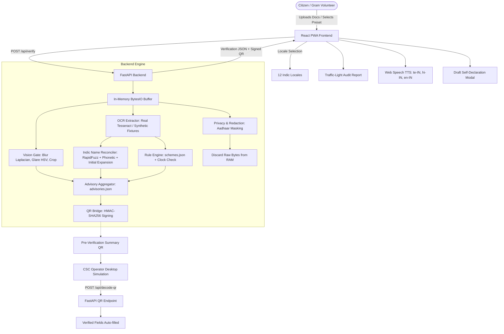

# SevaDristi — Implementation Plan

## 1. Project Overview & Architecture

**SevaDristi** is an offline-capable, multilingual document pre-verification assistant for citizens, Gram/Ward volunteers, and MeeSeva / CSC operators in Telangana. It helps flag quality issues (blur, glare, cropping), name and date discrepancies, and missing requirements *before* citizens travel to service centres.

> **Disclaimer**: SevaDristi is a pre-verification advisory tool for hackathon/demonstration purposes, not an official government authorization service.

### 1.1 Directory Tree

```text
SFIC/
├── architecture.md
├── IMPLEMENTATION_PLAN.md
├── README.md
├── VERIFICATION_REPORT.md
├── backend/
│   ├── main.py
│   ├── requirements.txt
│   ├── api/
│   │   ├── __init__.py
│   │   ├── verify.py
│   │   └── qr.py
│   ├── models/
│   │   ├── __init__.py
│   │   └── schemas.py
│   ├── services/
│   │   ├── __init__.py
│   │   ├── vision_gate.py
│   │   ├── ocr_extractor.py
│   │   ├── reconciler.py
│   │   ├── rule_engine.py
│   │   ├── qr_bridge.py
│   │   └── privacy.py
│   ├── rules/
│   │   └── schemes.json
│   ├── locales/
│   │   └── advisories.json
│   ├── fixtures/
│   │   └── synthetic_cases.json
│   └── tests/
│       ├── __init__.py
│       ├── test_reconciler.py
│       ├── test_vision_gate.py
│       ├── test_rule_engine.py
│       ├── test_privacy.py
│       ├── test_qr.py
│       └── test_api.py
└── frontend/
    ├── package.json
    ├── vite.config.ts
    ├── tsconfig.json
    ├── tailwind.config.js
    ├── postcss.config.js
    ├── index.html
    ├── public/
    │   ├── manifest.json
    │   ├── sw.js
    │   └── favicon.svg
    └── src/
        ├── main.tsx
        ├── App.tsx
        ├── index.css
        ├── components/
        │   ├── Header.tsx
        │   ├── SchemeSelector.tsx
        │   ├── DocumentUploader.tsx
        │   ├── PresetSelector.tsx
        │   ├── AuditReport.tsx
        │   ├── WageSavedDashboard.tsx
        │   ├── OperatorView.tsx
        │   ├── SelfDeclarationModal.tsx
        │   ├── AudioAdvisoryPlayer.tsx
        │   └── OfflineIndicator.tsx
        ├── pages/
        │   ├── CitizenView.tsx
        │   └── OperatorDesktop.tsx
        ├── services/
        │   ├── api.ts
        │   └── tts.ts
        ├── hooks/
        │   ├── useTranslation.ts
        │   └── useOnlineStatus.ts
        ├── locales/
        │   ├── en-IN.json
        │   ├── hi-IN.json
        │   ├── te-IN.json
        │   ├── ta-IN.json
        │   ├── kn-IN.json
        │   ├── ml-IN.json
        │   ├── mr-IN.json
        │   ├── bn-IN.json
        │   ├── gu-IN.json
        │   ├── or-IN.json
        │   ├── pa-IN.json
        │   └── as-IN.json
        └── types/
            └── index.ts
```

---

## 2. Module Responsibilities & Dependency Boundaries

| Module | Responsibility | Inbound Dependencies | Outbound Dependencies |
|---|---|---|---|
| `backend.services.vision_gate` | Blur detection (Laplacian variance), Glare analysis (HSV), Contour crop & perspective transform, Heuristic seal & signature presence | None (Standalone CV) | OpenCV, NumPy, Pillow |
| `backend.services.ocr_extractor` | Document type identification, text extraction, field parsing, confidence scoring, Aadhaar masking | `backend.services.privacy` | Pytesseract / local OCR or simulated engine, Regex |
| `backend.services.reconciler` | Unicode normalization, honorific stripping, token distance, Indic phonetic similarity, initial expansion detection, composite scoring | None | RapidFuzz, unicodedata, re |
| `backend.services.rule_engine` | Evaluates scheme requirements (required docs, field validity, expiry, income/age threshold) using injectable clock | `backend.rules.schemes.json` | datetime, pydantic |
| `backend.services.qr_bridge` | Issues tamper-proof HMAC-SHA256 signed Pre-Verification Summary QR; verifies integrity, expiry, issuer | None | hashlib, hmac, base64, zlib, json, qrcode |
| `backend.services.privacy` | In-memory upload processing (`io.BytesIO`), PII redaction (black banner on Aadhaar region), memory zeroing / buffer discard, masking routines | None | PIL, io, re |
| `backend.api.verify` | Endpoint `POST /api/verify`: coordinates vision, OCR, reconciler, rule engine, and advisories | All backend services | FastAPI, Pydantic |
| `backend.api.qr` | Endpoint `POST /api/decode-qr`: decodes and validates incoming QR tokens | `backend.services.qr_bridge` | FastAPI, Pydantic |

---

## 3. API Contracts

### 3.1 POST /api/verify

- **URL**: `/api/verify`
- **Method**: `POST`
- **Content-Type**: `multipart/form-data`

#### Request Parameters
- `documents`: List of image files (`UploadFile`, max 10MB each, MIME `image/jpeg`, `image/png`, `image/webp`).
- `scheme_id`: String (e.g. `epass_scholarship`, `aasara_pension`, `rythu_bharosa`).
- `language`: String locale code (e.g. `te-IN`, `hi-IN`, `en-IN`). Default `en-IN`.
- `demo_preset`: Optional string (`preset_1_red`, `preset_2_yellow`, `preset_3_green`, `preset_4_glare_seal`).
- `simulation_enabled`: Optional boolean (`true`/`false`). Restricted to demo presets; rejected or marked as `SIMULATED RESULT` when preset is active.

#### Success Response (`200 OK`)
```json
{
  "session_id": "ephem-8f3b1c9a",
  "processing_mode": "demo",
  "overall_status": "NEEDS_REVIEW",
  "documents": [
    {
      "id": "doc-1",
      "doc_type": "IDENTITY_CARD",
      "blur_score": 142.5,
      "blur_threshold": 110.0,
      "is_blurred": false,
      "glare_ratio": 0.02,
      "glare_threshold": 0.08,
      "has_glare": false,
      "crop_applied": true,
      "possible_seal_detected": false,
      "possible_signature_detected": true,
      "extracted_fields": {
        "full_name": "SARIPILLY RAKESH",
        "dob": "2001-08-14",
        "id_reference": "XXXX-XXXX-9123"
      },
      "ocr_confidence": 0.94,
      "preview_data_url": "data:image/jpeg;base64,..."
    }
  ],
  "field_comparisons": [
    {
      "field_name": "full_name",
      "doc_a_type": "IDENTITY_CARD",
      "doc_a_val": "SARIPILLY RAKESH",
      "doc_b_type": "RATION_CARD",
      "doc_b_val": "S. RAKESH",
      "status": "WARNING_INITIAL_EXPANSION",
      "composite_score": 0.88,
      "details": {
        "token_similarity": 0.85,
        "phonetic_similarity": 0.95,
        "initial_expanded": true,
        "explanation": "Initial 'S.' expanded to 'SARIPILLY'. Advise self-declaration or confirmation."
      }
    }
  ],
  "quality_issues": [
    {
      "code": "IMAGE_GLARE",
      "severity": "WARNING",
      "doc_id": "doc-2",
      "message": "High glare detected (15.2%). Ensure text remains legible."
    }
  ],
  "scheme_issues": [
    {
      "code": "CERT_EXPIRY",
      "severity": "ERROR",
      "doc_type": "INCOME_CERT",
      "message": "Income certificate issue date (2024-05-10) exceeds validity window for scheme."
    }
  ],
  "advisories": [
    {
      "id": "INITIAL_EXPANSION",
      "category": "NAME_MATCHING",
      "severity": "WARNING",
      "title": "Initial Expansion Detected",
      "description": "Name matches with initial abbreviation. A gazette or self-declaration may be requested by the operator.",
      "actionable_step": "Carry both documents or prepare a Name Self-Declaration form."
    }
  ],
  "rule_version": "2026.1",
  "rule_source": "Telangana State Portal Gazette / MeeSeva Guidelines",
  "qr_available": true,
  "qr_payload": "eyJ2ZXIiOiIxLjAiL...",
  "qr_data_url": "data:image/png;base64,...",
  "limitations": [
    "Pre-verification heuristics only. Final acceptance rests with the MeeSeva authority."
  ]
}
```

#### Validation Errors & Status Codes
- `400 Bad Request`: Invalid MIME type, file exceeds 10MB, unsupported `scheme_id`.
- `422 Unprocessable Entity`: Malformed JSON or form payload.
- `503 Service Unavailable`: If live OCR is required but no OCR engine is installed (with explicit `OCR_UNAVAILABLE` payload).

---

### 3.2 POST /api/decode-qr

- **URL**: `/api/decode-qr`
- **Method**: `POST`
- **Content-Type**: `application/json`

#### Request Body
```json
{
  "qr_payload": "eyJhbGciOiJIUzI1NiIsInR5cCI6IkpXVCJ9..."
}
```

#### Success Response (`200 OK`)
```json
{
  "valid_signature": true,
  "not_expired": true,
  "issuer": "SevaDristi-v1",
  "scheme_id": "epass_scholarship",
  "session_ref": "ephem-8f3b1c9a",
  "pre_verification_status": "NEEDS_REVIEW",
  "verified_fields": {
    "applicant_name_masked": "S******* RAKESH",
    "dob_year": "2001",
    "docs_verified_count": 3
  },
  "verification_scope": "Pre-verification summary: quality checked, name reconciled, validity checked.",
  "issued_at": "2026-10-22T10:00:00Z",
  "expires_at": "2026-10-29T10:00:00Z",
  "warnings": [
    "Initial expansion detected between Identity and Ration Card."
  ]
}
```

#### Tampered or Expired Response (`200 OK` with flags or `400 Bad Request`)
```json
{
  "valid_signature": false,
  "not_expired": false,
  "issuer": null,
  "scheme_id": null,
  "verified_fields": {},
  "verification_scope": "NONE",
  "warnings": [
    "Signature verification failed: Payload has been tampered with or signing key mismatch."
  ]
}
```

---

## 4. Mermaid Data-Flow Diagram



---

## 5. Internationalization Architecture (12 Languages)

### 5.1 Supported Locales
1. `en-IN` (English)
2. `hi-IN` (हिन्दी)
3. `te-IN` (తెలుగు) - *Primary Focus for MeeSeva*
4. `ta-IN` (தமிழ்)
5. `kn-IN` (ಕನ್ನಡ)
6. `ml-IN` (മലയാളം)
7. `mr-IN` (मराठी)
8. `bn-IN` (বাংলা)
9. `gu-IN` (ગુજરાતી)
10. `or-IN` (ଓଡ଼ିଆ)
11. `pa-IN` (ਪੰਜਾਬੀ)
12. `as-IN` (অসমীয়া)

### 5.2 Translation Completeness & Testing
- JSON translation dictionaries for all 12 locales located under `frontend/src/locales/{locale}.json`.
- Stable keys across all files covering headers, buttons, presets, quality checks, mismatch explanations, scheme requirements, privacy disclaimers, and operator views.
- Automated parity test in frontend test suite checking that 100% of keys in `en-IN.json` exist and are non-empty in all 11 other locale files.
- Backend advisory catalog `backend/locales/advisories.json` provides localized title, description, and actionable steps for stable advisory codes (`INITIAL_EXPANSION`, `NAME_MISMATCH`, `CERT_EXPIRY`, `IMAGE_BLUR`, `IMAGE_GLARE`, etc.).

### 5.3 Text-to-Speech (TTS)
- Uses HTML5 `window.speechSynthesis`.
- Automatically inspects available voices via `speechSynthesis.getVoices()`.
- Prioritizes native voice match for the active locale (e.g. `te-IN` voice for Telugu).
- Graceful fallback: If no Telugu or regional voice is installed in the user's OS/browser, displays clear notice and fallback to English voice or readable alert text.
- Includes Play, Pause, Stop, and Speaking animation indicator.

---

## 6. Privacy & Temporary-File Lifecycle

1. **Zero-Disk Ingestion**: Files uploaded via FastAPI `UploadFile` are read directly as bytes in memory (`io.BytesIO`). No temporary files are saved to `tempfile` or disk.
2. **Immediate Masking**: Aadhaar numbers matching regex `\b\d{4}\s?\d{4}\s?\d{4}\b` are masked to `XXXX-XXXX-1234` in memory immediately after OCR extraction.
3. **Redacted Previews**: When synthetic or detected Aadhaar card images are rendered, the first 8 digits are overlaid with a solid black rectangle marked `[Aadhaar Redacted]`.
4. **Log Sanitization**: FastAPI logging middleware strips request file content, OCR raw strings, and PII from console logs.
5. **No Persistent Client Cache**: Service worker and `localStorage` are strictly forbidden from caching uploaded documents or verification reports. Only static app shell (`.js`, `.css`, icons, translation JSONs) is cached.
6. **Session Reset**: A dedicated "Clear / Reset Session" button purges in-memory state in the frontend and unloads preview data URLs.

---

## 7. Scheme-Rule Configuration & Provenance

Configured in `backend/rules/schemes.json`:

1. **Telangana ePASS Post-Matric Scholarship** (`epass_scholarship`)
   - *Jurisdiction*: Telangana State
   - *Required Documents*: `IDENTITY_CARD`, `CASTE_CERT`, `INCOME_CERT`, `BANK_PASSBOOK`
   - *Income Threshold*: Max INR 2,00,000 (Rural) / 2,50,000 (Urban)
   - *Validity Period*: Income certificate valid for 1 year from issue date
   - *Rule Provenance*: Telangana ePASS Portal / GO Ms No. 45
   - *Verification Status*: `VERIFIED`

2. **Aasara / Cheyutha Pension** (`aasara_pension`)
   - *Jurisdiction*: Telangana State
   - *Required Documents*: `IDENTITY_CARD`, `RATION_CARD`, `BANK_PASSBOOK`
   - *Age Threshold*: Minimum 57 years (Old Age) / Disability certificate (Disabled)
   - *Rule Provenance*: PR&RD Dept Telangana / Aasara Guidelines
   - *Verification Status*: `VERIFIED`

3. **Rythu Bharosa** (`rythu_bharosa`)
   - *Jurisdiction*: Telangana State
   - *Required Documents*: `IDENTITY_CARD`, `LAND_PASSBOOK` (Pattadar Passbook), `BANK_PASSBOOK`
   - *Rule Provenance*: Department of Agriculture Telangana
   - *Verification Status*: `DEMO_ONLY` (Rules undergoing active state update; flagged as `RULE_REQUIRES_CONFIRMATION`)

---

## 8. Indic Name Reconciliation Algorithm

### 8.1 Multi-Stage Pipeline
1. **Unicode Cleanup**: Decompose and normalize via `unicodedata.normalize('NFKD', text)`, strip non-alphanumeric/spaces, collapse whitespaces.
2. **Honorific Stripping**: Remove prefixes/suffixes such as `Sri`, `Smt`, `Kumari`, `Garu`, `Shri`, `Mr`, `Mrs`, `Dr`.
3. **Initial Expansion Detector**:
   - Detect tokens of length 1 followed by dot (e.g. `S.` or `S `).
   - Match against surname tokens in counterpart document (e.g., `S.` vs `SARIPILLY`).
   - If initial matches the first letter of counterpart surname, tag as `INITIAL_EXPANSION` with `0.85` provisional confidence.
4. **Indic Phonetic Normalizer**:
   - Equivalence mapping for common South Asian transliteration variants:
     - `EE` <-> `I` (e.g., `SARIPILLY` vs `SARIPILLI`)
     - `OO` <-> `U` (e.g., `KUMAR` vs `KOOMAR`)
     - `V` <-> `W` (e.g., `VENKAT` vs `WENKAT`)
     - `TH` <-> `T` (e.g., `SWATHI` vs `SWATI`)
     - `BH` <-> `B`, `DH` <-> `D`, `GH` <-> `G`, `KH` <-> `K`, `PH` <-> `P`
5. **Fuzzy Token Matching**:
   - Uses `rapidfuzz.fuzz.token_sort_ratio` and `rapidfuzz.distance.Levenshtein`.
6. **Composite Scoring**:
   $$\text{Score} = 0.40 \times \text{TokenSortRatio} + 0.35 \times \text{PhoneticRatio} + 0.25 \times \text{CharLevenshtein}$$
7. **Decision Classification**:
   - $\ge 0.92$: `GREEN_MATCH`
   - Initial Expansion Detected: `WARNING_INITIAL_EXPANSION`
   - $0.70 \le \text{Score} < 0.92$: `YELLOW_REVIEW`
   - $< 0.70$ or Different Surnames: `RED_MISMATCH`

---

## 9. QR Payload Structure, Signing & Verification

### 9.1 Signing Mechanism
- Algorithm: **HMAC-SHA256**
- Secret: Configurable via environment variable `SEVADRISTI_QR_SECRET` (default fallback secret for demo mode with warning).
- Format: Base64URL-encoded payload concatenated with Base64URL-encoded signature (`payload.signature`).

### 9.2 Payload Contents (Privacy-Preserving)
```json
{
  "v": "1.0",
  "iss": "SevaDristi-v1",
  "sid": "ephem-8f3b1c9a",
  "sch": "epass_scholarship",
  "st": "NEEDS_REVIEW",
  "iat": 1774176000,
  "exp": 1774780800,
  "f": {
    "nam": "S******* RAKESH",
    "dob": "2001-**-**",
    "pin": "500032",
    "cnt": 3
  },
  "w": ["INITIAL_EXPANSION"]
}
```

---

## 10. Demo Presets vs Real Processing

| Preset | Document Set | Quality Heuristic | Reconciler Outcome | Rule Outcome | Final Status |
|---|---|---|---|---|---|
| **Preset 1 (RED: Multiple Issues)** | Identity (`SARIPILLY RAKESH`), Ration (`S. RAKESH`), Bank (`KONDAPALLI RAKESH`), Income (`2024-05-10`) | Bank Passbook simulated blur (Var = 65.0 < 110.0) | Mismatch between Saripilly and Kondapalli | Income Cert expired (>1 yr) | `RED_MISMATCH / REJECTED` |
| **Preset 2 (YELLOW: Initial & Phonetics)** | Identity (`SARIPILLY RAKESH`), Ration (`SARIPILLI RAKESH`), Bank (`S. RAKESH`) | Sharp, Glare < 4% | Phonetic match (`Y` vs `I`) + Initial expansion (`S.`) | All docs present, valid dates | `YELLOW_REVIEW / NEEDS_REVIEW` |
| **Preset 3 (GREEN: No Issues)** | Identity (`SARIPILLY RAKESH`), Caste (`SARIPILLY RAKESH`), Income (`SARIPILLY RAKESH`, issue 2026-03), Bank (`SARIPILLY RAKESH`) | Sharp (Var = 240.0), Glare = 1.5% | Exact / High match across all docs | All valid, income <= 2L | `GREEN_MATCH / NO_ISSUES_DETECTED` |
| **Preset 4 (GLARE & SEAL REVIEW)** | Identity & Income Cert | Glare = 15.2% (> 8.0%), Seal detection uncertain | Name matches | Quality warning & Seal heuristic review | `YELLOW_REVIEW / NEEDS_REVIEW` |

---

## 11. Test Plans

### 11.1 Backend Test Plan (`pytest`)
- `test_reconciler.py`:
  - Test 1: `SARIPILLY RAKESH` vs `SARIPILLI RAKESH` -> High phonetic score (`>= 0.95`).
  - Test 2: `S. RAKESH` vs `SARIPILLY RAKESH` -> `WARNING_INITIAL_EXPANSION`.
  - Test 3: `SARIPILLY RAKESH` vs `KONDAPALLI RAKESH` -> `RED_MISMATCH`.
  - Test 4: Unicode normalization and honorific removal.
  - Test 5: Empty and malformed strings.
- `test_vision_gate.py`:
  - Test sharp vs blurred synthetic images.
  - Test high-glare image vs clean image.
  - Test perspective crop on synthetic quadrilateral.
  - Test seal and signature heuristic metrics.
- `test_rule_engine.py`:
  - Test missing required document.
  - Test certificate validity against an injected clock.
  - Test income threshold evaluation.
  - Test unverified scheme flagging (`RULE_REQUIRES_CONFIRMATION`).
- `test_privacy.py`:
  - Test that Aadhaar numbers (e.g. `2345 6789 0123`) are never returned unmasked in API responses.
  - Test that no image file is written to local filesystem during verify.
  - Test log sanitization filter.
- `test_qr.py`:
  - Test valid QR generation and signature verification.
  - Test tampered payload detection.
  - Test expired QR payload.
- `test_api.py`:
  - Test `/api/verify` with all 4 presets.
  - Test `/api/decode-qr` with valid and invalid tokens.

### 11.2 Frontend Test & Build Plan
- `npm run build`: Type-checking and bundle verification.
- Translation completeness check across all 12 languages.
- Preset switching and rendering validation.

---

## 12. Ordered Implementation Checklist & Acceptance Criteria

1. [x] Implementation Plan artifact created (`IMPLEMENTATION_PLAN.md`).
2. [ ] Backend rule definitions (`backend/rules/schemes.json`) & advisory catalog (`backend/locales/advisories.json`).
3. [ ] Synthetic demo cases fixture (`backend/fixtures/synthetic_cases.json`).
4. [ ] Backend Core Services:
   - `vision_gate.py` (blur, glare, crop, seal/signature heuristics)
   - `privacy.py` (Aadhaar redaction, masking, zero-disk buffers)
   - `ocr_extractor.py` (local OCR adapter + demo fixture fallback)
   - `reconciler.py` (Indic phonetic + initial expansion + token matching)
   - `rule_engine.py` (scheme evaluation with injectable clock)
   - `qr_bridge.py` (HMAC-SHA256 signing and verification)
5. [ ] FastAPI routes & schemas (`backend/models/schemas.py`, `backend/api/verify.py`, `backend/api/qr.py`, `backend/main.py`).
6. [ ] Backend automated tests in `backend/tests/` and execution with `pytest`.
7. [ ] Frontend initialization with Vite + React + TypeScript + Tailwind CSS.
8. [ ] Frontend 12-language translation files in `frontend/src/locales/`.
9. [ ] Citizen / Volunteer UI:
   - Header with 12-language selector, privacy badge, offline status.
   - Scheme selector cards with verified/unverified markers.
   - 4 Jury demo presets for instant review.
   - Live document upload, crop/rotate, quality badges.
   - Audit report with traffic-light status, discrepancy explanations, and spoken advisory TTS.
   - Signed Pre-Verification Summary QR generation.
   - Self-declaration draft generator for initial expansion cases.
   - Wage-saved simulated impact dashboard.
10. [ ] CSC Operator Desktop UI:
    - Service application form simulation.
    - QR scanner / file decoder.
    - Tamper detection and verified field auto-fill.
11. [ ] PWA manifest & service worker for offline app-shell caching.
12. [ ] End-to-end integration: Start FastAPI & Vite dev servers, verify in browser, capture results.
13. [ ] Create `README.md` and `VERIFICATION_REPORT.md` documenting verified functionality and limitations.
