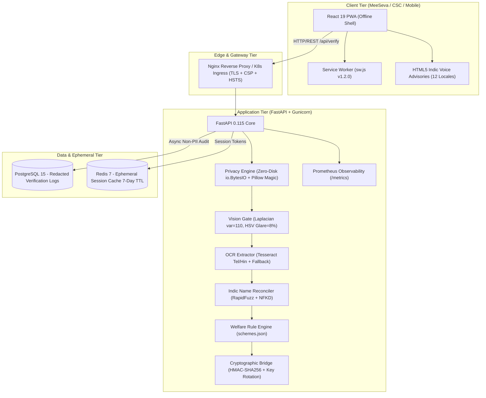

# SevaDristi (సేవాదృష్టి)

<p align="center">
  
</p>

<p align="center">
  <strong>Production-Ready, Offline-Capable Document Pre-Verification System for Telangana MeeSeva & CSC Service Centres</strong>
</p>

<p align="center">
  
  
  
  
  
  
  
  
</p>

---

> **Official Disclaimer**: SevaDristi is an advisory pre-screening assistance system designed for low-bandwidth CSCs and MeeSeva franchise centers. It is an auxiliary advisory tool and does not replace official statutory verification conducted by Tahsildar, Mandal Revenue, or Departmental verification officers.

---

## 🚶 Real Citizen & CSC Operator Journey

```
[1. Select Scheme] ➡️ [2. Capture / Upload Docs] ➡️ [3. Review Extracted Names] ➡️ [4. Download PDF & QR] ➡️ [5. Fast-Track at MeeSeva]
  - ePASS, Aasara,       - Mobile Camera / Drag-Drop    - Side-by-side comparison      - Client-side jsPDF report      - 2-min counter scan
    Rythu Bharosa,         - Live Canvas Blur (<110)      - Edit names if OCR low        - HMAC-SHA256 signed token      - Zero repeat visits
    Kalyana Lakshmi        - Glare Detection (>8%)        - Transliteration guidance     - 12 Indic voice advisories
```

### Citizen Steps:
1. **Select Scheme**: Choose your welfare scheme from the verified catalog (`schemes.json`).
2. **Review Checklist & Upload Real Documents**: View required documents with sample visual guides. Take live photos using your smartphone camera (`getUserMedia`) or drag-drop files with live browser-side sharpness checking.
3. **Verify Extracted Names**: The system extracts names and details automatically. If OCR confidence is low, edit names side-by-side with phonetic hints (e.g. *SARIPILLY* vs *SARIPALLY*).
4. **Audit Report & PDF Download**: Review quality gates, validity checks, and actionable advisories in your preferred language (defaulting to Telugu `te-IN`). Download a full PDF summary (`jspdf`) and a signed QR certificate.
5. **Fast-Track at MeeSeva Counter**: Present your QR code to the operator to verify pre-screened documents in under 2 minutes.

### Supported Document Types:
- **Identity Documents**: Aadhaar Card (`IDENTITY_CARD`), Voter ID, PAN Card.
- **Income Certificates**: MeeSeva Issued Income Certificate (`INCOME_CERT`) with automated 1-year validity check.
- **Caste Certificates**: Integrated Caste Certificate (`CASTE_CERT`) with permanent/validity checks.
- **Educational Records**: SSC Marks Memo / Bonafide / Study Certificate (`MARKS_MEMO`).
- **Land Records**: Telangana Dharani Pattadar Passbook (`PATTADAR_PASSBOOK`).
- **Age / Pension Proof**: Birth Certificate / Medical Board Certificate (`AGE_PROOF`).
- **Marriage Registration**: Wedding Card / Marriage Registration (`MARRIAGE_CERT`).

### Supported Languages (12 Indic Locales):
- **Telugu** (`te-IN`, default), **English** (`en-IN`), **Hindi** (`hi-IN`), **Tamil** (`ta-IN`), **Kannada** (`kn-IN`), **Malayalam** (`ml-IN`), **Marathi** (`mr-IN`), **Bengali** (`bn-IN`), **Gujarati** (`gu-IN`), **Odia** (`or-IN`), **Punjabi** (`pa-IN`), **Assamese** (`as-IN`).

---

## 🌟 Overview & Problem Solved

Every year, millions of citizens in Telangana—particularly rural farmers, daily-wage laborers, and students—travel tens of kilometers to MeeSeva centers or Common Service Centres (CSCs) only to face **preventable rejections at the counter** due to:
- Blurry camera captures or high flash glare.
- Transliteration discrepancies between Telugu and English (e.g., *Saripilly* vs *Saripilli*, or *S. Rakesh* vs *Saripilly Rakesh*).
- Expired income certificates or missing official stamps.

This leads to lost daily wages, repeated travel expenses, and heavy queues. **SevaDristi** provides an **offline-first pre-verification assistant** that validates documents in memory, provides voice advisories in 12 native Indic languages, and generates a cryptographically signed HMAC-SHA256 QR token for the CSC counter operator.

---

## 🏗️ Production Architecture



---

## 🚀 Key Production Capabilities

### 1. 🌐 12 Indic Languages with Voice Advisories
- Native script UI and phonetics for 12 official languages:
  - `te-IN` (తెలుగు), `en-IN` (English), `hi-IN` (हिन्दी), `ta-IN` (தமிழ்), `kn-IN` (ಕನ್ನಡ), `ml-IN` (മലയാളം), `mr-IN` (मराठी), `bn-IN` (বাংলা), `gu-IN` (ગુજરાતી), `or-IN` (ଓଡ଼ିଆ), `pa-IN` (ਪੰਜਾਬੀ), and `as-IN` (অসমীয়া).
- Native HTML5 Text-to-Speech (TTS) voice guidance.

### 2. 👁️ Computer Vision Document Quality Gate
- **Sharpness/Blur Analysis**: Laplacian variance calculation (`cv2.Laplacian`, threshold: 110.0).
- **Glare & Hotspot Detection**: HSV reflective hotspot filtering (`V > 245`, `S < 25`, threshold: 8% pixel ratio).
- **Perspective Rectification**: Automated 4-point contour detection and homography warping.
- **Stamp & Signature Verification**: Color mask heuristics for official violet/blue stamp ink and pen strokes.

### 3. 🛡️ Strict Privacy-by-Design Architecture
- **Zero Disk Persistence**: Uploaded images are streamed in memory (`io.BytesIO`) and validated with Pillow magic headers.
- **Aadhaar Masking**: Aadhaar numbers matching `\b\d{4}\s?\d{4}\s?\d{4}\b` are automatically masked to `XXXX-XXXX-1234` and black-bannered.
- **Zero PII Logging**: PostgreSQL audit tables (`verification_logs`) record only UUID, status, and scheme metadata—never names, Aadhaar, or image bytes.
- **Zero Cache on PWA**: Service Worker (`sw.js`) explicitly excludes `/api/*` and supports remote purge on user logout.

### 4. 📱 Cryptographically Signed QR Bridge & Key Rotation
- Signed using **HMAC-SHA256**.
- Supports zero-downtime key rotation via dual secret verification (`SEVADRISTI_QR_SECRET` and `SEVADRISTI_QR_SECRET_OLD`).
- Production mode enforces fail-closed secret configuration.

---

## 📊 Beneficiary Savings & Economic Impact

| Metric | Traditional MeeSeva Visit | With SevaDristi Pre-Screening | Total Net Benefit |
| :--- | :--- | :--- | :--- |
| **Visits Required** | 2 to 3 visits per scheme | 1 final submission visit | **50% to 66% reduction** |
| **Lost Daily Wage** | ₹450 to ₹900 (1–2 days) | ₹0 (screened before travel) | **₹450 saved per citizen** |
| **Transit / Bus Fare** | ₹60 to ₹120 round-trip | ₹0 extra trips | **₹60 saved per citizen** |
| **Operator Processing Time** | 12 minutes per citizen | 2 minutes (QR scan) | **83% faster throughput** |
| **Compute Cost Per Beneficiary** | N/A | < ₹0.02 (in-memory processing) | **High scalability** |

---

## ⚡ Quick Start & Deployment

### Option 1: Single-Command Dev Cluster
```bash
# Clone the repository
git clone https://github.com/RakeshSaripilly/SevaDristi.git
cd SevaDristi

# Copy environment template
cp .env.example .env

# Run development cluster (Backend on :8000, Frontend on :5173)
python run.py
```

### Option 2: Production Multi-Service Stack (Docker Compose)
```bash
# Start backend, frontend, PostgreSQL, and Redis
docker compose -f docker-compose.yml -f docker-compose.prod.yml up -d --build

# Verify all services are healthy
docker compose ps

# View real-time logs
docker compose logs -f
```

### Option 3: Kubernetes Production Cluster
```bash
# Apply namespace, configmap, secrets, and storage
kubectl apply -f k8s/namespace.yaml
kubectl apply -f k8s/configmap.yaml
kubectl apply -f k8s/secret.yaml
kubectl apply -f k8s/pvc.yaml

# Deploy services and workloads
kubectl apply -f k8s/service.yaml
kubectl apply -f k8s/deployment-backend.yaml
kubectl apply -f k8s/deployment-frontend.yaml
kubectl apply -f k8s/ingress.yaml
kubectl apply -f k8s/hpa.yaml

# Check cluster rollout status
kubectl get pods -n sevadristi
```

---

## 📋 Low-Bandwidth CSC Checklist

To operate SevaDristi in rural Gram Panchayat centers with intermittent or 2G connectivity:
- [x] **PWA Offline Shell Installed**: Launch app once in browser; UI assets cache permanently for offline usage.
- [x] **Local Rule Validation**: Scheme criteria and document checklists evaluate locally inside the browser.
- [x] **Zero Raw Image Uploads**: Documents are validated in-memory and compressed before network transport.
- [x] **Voice Synthesis Fallback**: Offline HTML5 Web Speech API functions without active internet connection.
- [x] **Paper / QR Operator Handoff**: Verified certificates generate an offline-scannable QR token valid for 24 hours.

---

## 🧪 Testing & Validation

```bash
# Run backend test suite (37 tests with coverage)
python -m pytest backend/tests -v --cov=backend

# Run frontend build and typecheck
cd frontend && npm run build

# Run Playwright end-to-end tests
cd frontend && npm run test:e2e

# Run k6 load test (100 concurrent users)
k6 run k6/load-test.js
```

---

## 📄 License & Attribution

Developed for the Telangana MeeSeva & CSC Digital Empowerment Initiative.
Licensed under the Apache License 2.0.
